<div align="center">

```
███████╗██╗  ██╗██╗   ██╗██╗     ██╗███╗   ██╗███████╗
██╔════╝██║ ██╔╝╚██╗ ██╔╝██║     ██║████╗  ██║██╔════╝
███████╗█████╔╝  ╚████╔╝ ██║     ██║██╔██╗ ██║█████╗  
╚════██║██╔═██╗   ╚██╔╝  ██║     ██║██║╚██╗██║██╔══╝  
███████║██║  ██╗   ██║   ███████╗██║██║ ╚████║███████╗
╚══════╝╚═╝  ╚═╝   ╚═╝   ╚══════╝╚═╝╚═╝  ╚═══╝╚══════╝
```

**Airline Management System**

*A full-stack airline platform: Spring Boot microservices behind a gateway, and a React web app for passengers and operations staff*

---


<br />

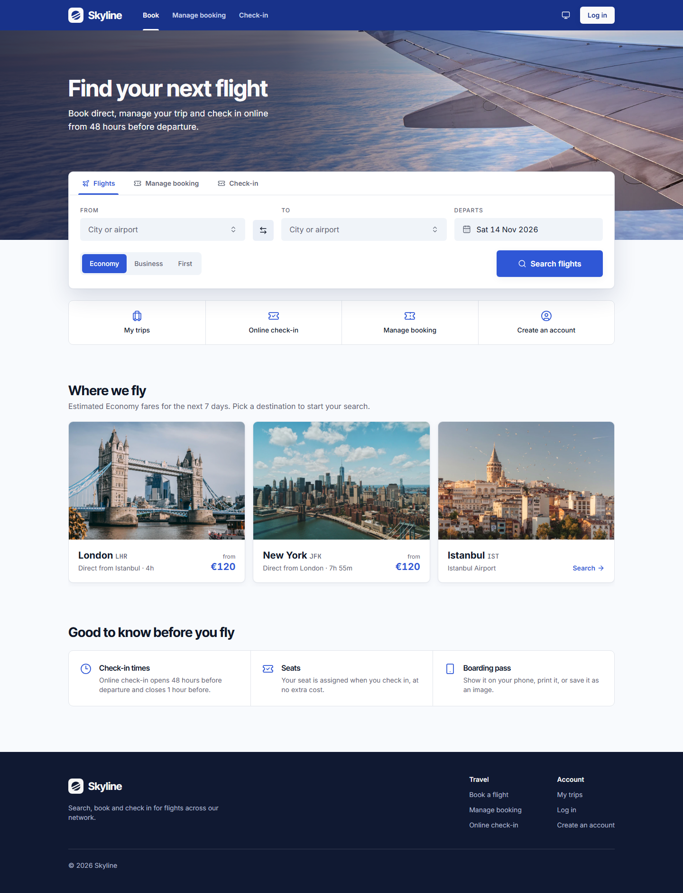

</div>

---

## Overview

Skyline is a backend REST API that manages the full lifecycle of airline operations — from aircraft fleet management and route scheduling to passenger reservations, check-in, and crew assignments.

The project is built as a **microservices architecture**: each bounded context runs as an independent Spring Boot application with its own database, communicating over HTTP (OpenFeign) and asynchronous events (Kafka). A Spring Cloud Gateway provides a unified API entry point.

**[skyline-web](skyline-web/README.md)** is the browser front-end on top of it: a React 19 + TypeScript single-page app with two faces. Passengers search flights, book, manage their trips, check in and get a boarding pass with a scannable PDF417 barcode. Operations staff run the flight board, walk flights through their status lifecycle, assign crew, and manage the fleet, network and user accounts. It talks to the gateway only, through the same `/api/v1` the services expose, and ships as an nginx container in the same `docker compose` stack.

---

## Walkthrough

Every screenshot below comes from the real app, running against its mocked API so the data is the same every time. One command regenerates them: see [Regenerating the screenshots](#regenerating-the-screenshots).

### Passenger journey

**1. Find a flight.** The home page (above) leads with a tabbed booking box: search flights, look up a booking by reference and last name, or check in. "Where we fly" lists every airport the route service knows, with the lowest estimated Economy fare over the next 7 days, found by searching each direct route day by day.

**2. Compare flights.** Results come from the schedule service (`GET /flights?origin=&destination=&date=`) and include delayed flights. Departures show in the origin airport's time zone and arrivals in the destination's, with `+1` when the local date changes. Prices are estimates that mirror the reservation service's rules, including the surcharge on nearly full flights. Hovering a nearby date prefetches its results.

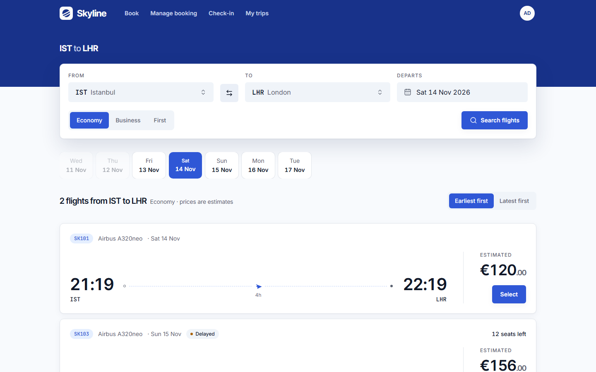

**3. Book in three steps.** Cabin, passenger, review. The cabin step previews the fare for each cabin (Economy 1×, Business 2.5×, First 4× the base fare). The passenger form validates as you go and links every error to its field.

<table>
  <tr>
    <td width="50%">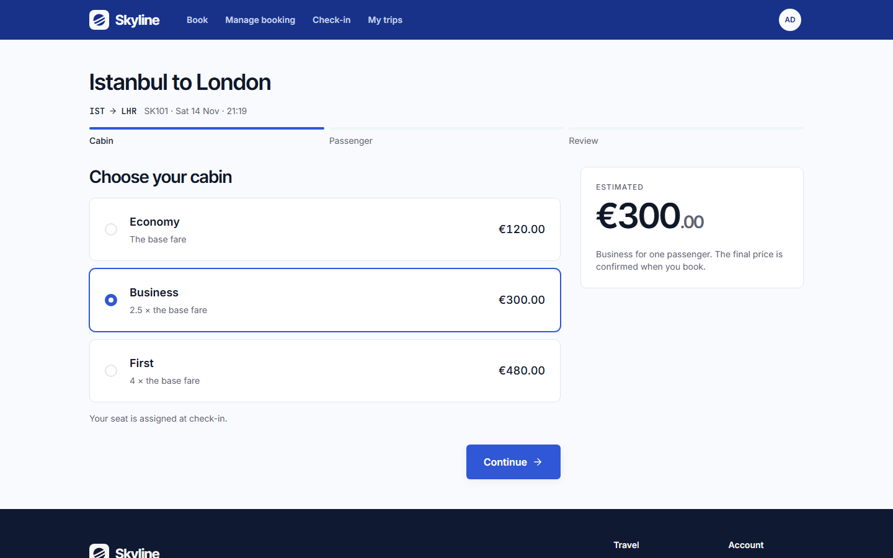</td>
    <td width="50%">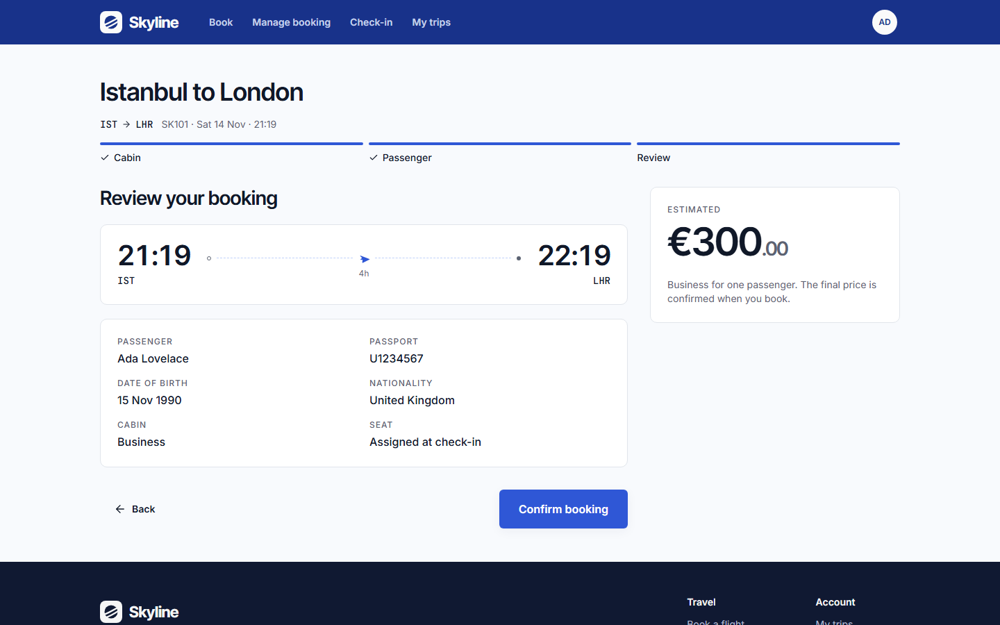</td>
  </tr>
</table>

**4. Confirmed.** `POST /reservations` holds a seat in the flight's inventory (the schedule service, over an internal service-key endpoint), computes the price on the server, and issues a six-character booking reference (PNR). The confirmation page shows the server's total, offers an `.ics` calendar file, and tells you when check-in opens.

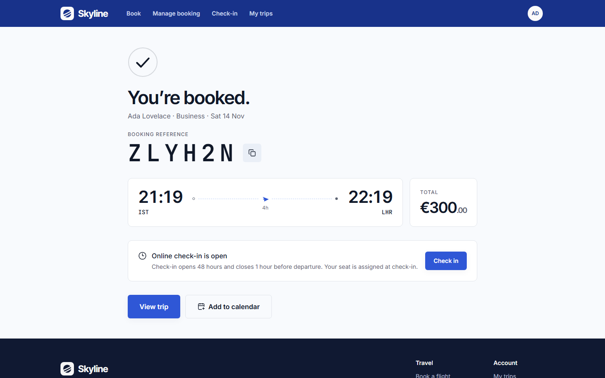

**5. My trips.** Upcoming, past and cancelled bookings. Cancelling a booking frees its seat on the flight.

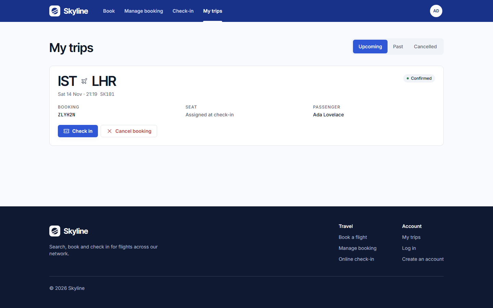

**6. Check in and board.** Check-in opens 48 hours before departure and closes 1 hour before. `POST /checkin` assigns a seat, marks the reservation `CHECKED_IN`, and returns the boarding pass. It's idempotent: checking in again returns the same pass. The pass carries a PDF417 barcode, prints cleanly, and downloads as an image.

<table>
  <tr>
    <td width="68%">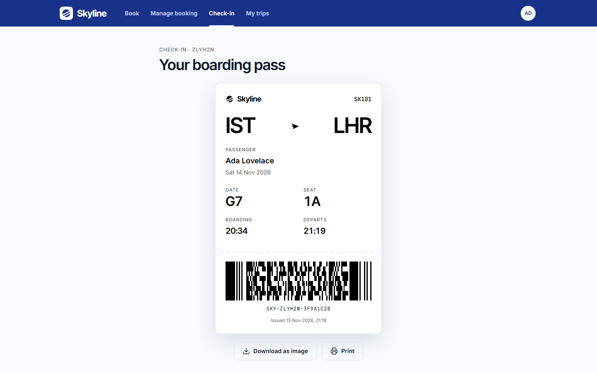</td>
    <td width="32%">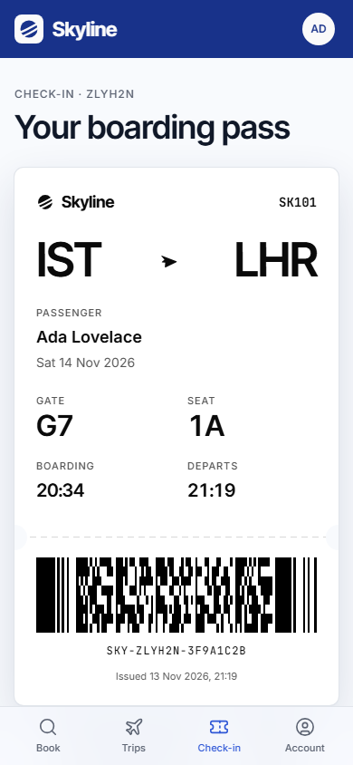</td>
  </tr>
</table>

### Operations console

Staff and admins get a separate console at `/ops`, gated by role: a passenger who opens it sees an access-denied page.

**7. Flight board.** Every flight on every status, filterable by date, route, status and flight number (`GET /flights/board`), with seats sold and base fares.

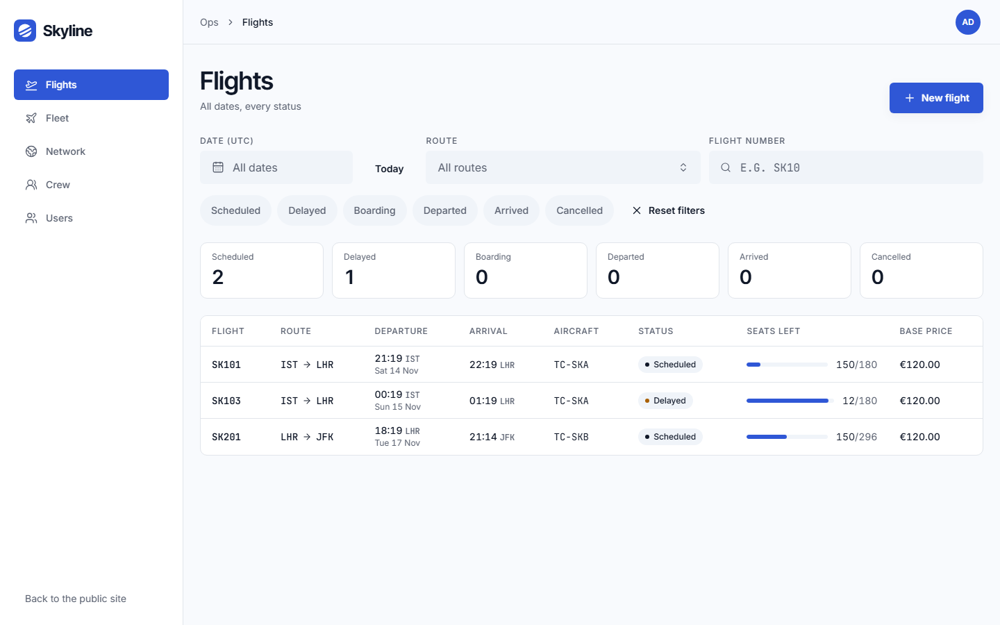

**8. Run a flight.** The status machine (`SCHEDULED → BOARDING → DEPARTED → ARRIVED`, with `DELAYED` and `CANCELLED` branches) offers only the moves allowed from the current state. Boarding is refused until a captain and a first officer are assigned (the schedule service checks with the crew service). Cancelling is admin-only, and every booking on the flight is cancelled through a Kafka event.

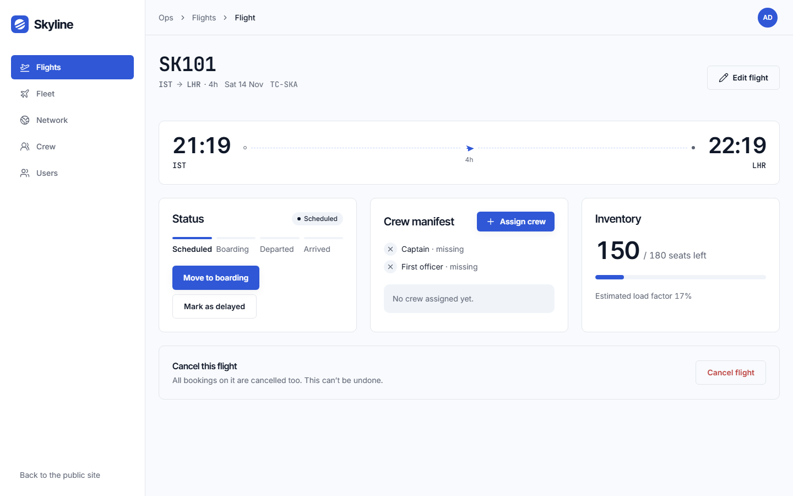

**9. Fleet, network, crew and users.** Aircraft and aircraft types (only `ACTIVE` aircraft can be scheduled), airports and routes, crew members with licence expiry dates, and staff accounts that an admin creates.

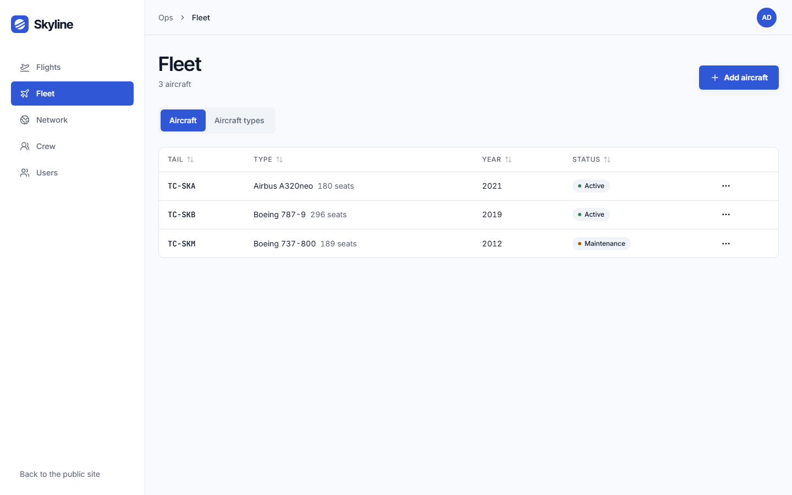

### Dark mode and phones

The theme follows the system, or the account menu's System / Light / Dark switch. Every screen is laid out for phones down to 375px wide, with a bottom tab bar.

<table>
  <tr>
    <td width="70%">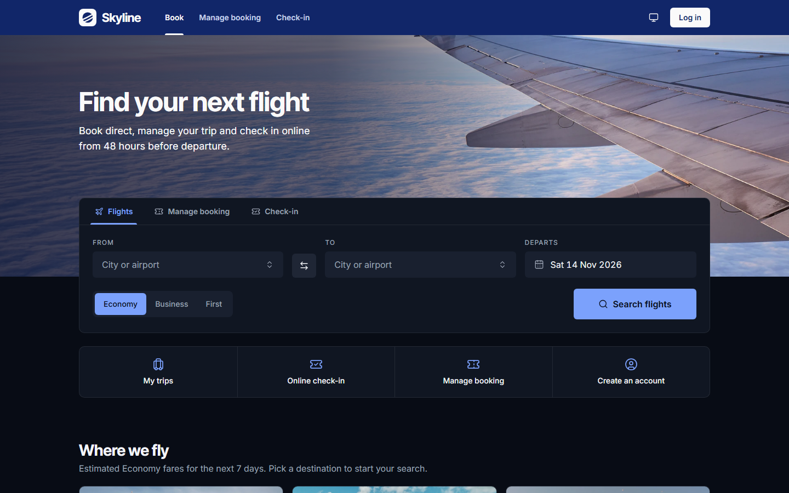</td>
    <td width="30%">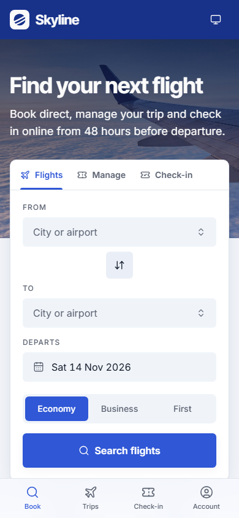</td>
  </tr>
</table>

### Regenerating the screenshots

A Playwright spec drives the app against its mocked API and writes the images to `.github/screenshots`:

```bash
cd skyline-web
SCREENSHOTS=1 pnpm exec playwright test e2e/screenshots.spec.ts
```

---

## Architecture

```
                    ┌────────────────────────┐
                    │  skyline-web (React)   │ :5173
                    │  nginx, /api → gateway │
                    └───────────┬────────────┘
                         ┌──────┴───────┐
                         │   Gateway    │ :8000
                         │  (routing)   │
                         └──────┬───────┘
           ┌────────┬────────┬──┴──┬────────┬────────┬────────┐
           ▼        ▼        ▼     ▼        ▼        ▼        ▼
      ┌────────┐┌────────┐┌─────┐┌────┐┌──────────┐┌───────┐┌──────┐
      │ Fleet  ││ Route  ││Auth ││Sched││Reserv.   ││CheckIn││ Crew │
      │ :8081  ││ :8082  ││:8083││:8080││  :8084   ││ :8085 ││:8086 │
      └───┬────┘└───┬────┘└──┬──┘└──┬─┘└────┬─────┘└───┬───┘└──┬───┘
          │         │        │      │       │          │       │
      ┌───┴──┐  ┌───┴──┐ ┌──┴──┐┌──┴──┐┌───┴───┐ ┌───┴──┐┌───┴──┐
      │PG    │  │PG    │ │PG   ││PG   ││PG     │ │PG    ││PG    │
      │:5434 │  │:5435 │ │:5433││:5436││:5437  │ │:5438 ││:5439 │
      └──────┘  └──────┘ └─────┘└─────┘└───────┘ └──────┘└──────┘

           ┌─────────┐              ┌─────────┐
           │  Redis  │ :6379        │  Kafka  │ :9092
           └─────────┘              └─────────┘
```

### Modules

| Module | Package | Purpose |
|---|---|---|
| `skyline-common` | `com.basarsy.skyline.common` | Shared library — JWT filter, `SecurityConfig`, `ApiResponse<T>`, `GlobalExceptionHandler`, Kafka topic config, Feign interceptors, `BaseEntity` |
| `skyline-gateway` | `com.basarsy.skyline.gateway` | Spring Cloud Gateway — routes all `/api/v1/**` traffic to the appropriate service |
| `skyline-auth` | `com.basarsy.skyline.user` | User accounts, registration, login, JWT token issuance and refresh |
| `skyline-fleet` | `com.basarsy.skyline.fleet` | Aircraft & aircraft type management |
| `skyline-route` | `com.basarsy.skyline.route` | Airports & route management |
| `skyline-schedule` | `com.basarsy.skyline.schedule` | Flight scheduling, status transitions, seat inventory |
| `skyline-reservation` | `com.basarsy.skyline.reservation` | Bookings, passengers, ticketing, PNR generation |
| `skyline-checkin` | `com.basarsy.skyline.checkin` | Online check-in & boarding passes |
| `skyline-crew` | `com.basarsy.skyline.crew` | Crew members & flight crew assignments |
| `skyline-e2e` | `com.basarsy.skyline.e2e` | End-to-end API tests through the gateway (`-Pe2e`) |
| `skyline-web` | — | React web app: passenger site and ops console ([README](skyline-web/README.md)) |

Each service owns its own `entity`, `dto`, `mapper`, `repository`, `service`, and `controller` packages. Cross-service communication uses **OpenFeign** HTTP clients — no shared entity references, only IDs cross boundaries.

---

## Tech Stack

| Layer | Technology |
|---|---|
| Language | Java 21 |
| Framework | Spring Boot 3.5 |
| Cloud | Spring Cloud 2025.0 (Gateway, OpenFeign) |
| Database | PostgreSQL 16 (one instance per service) |
| Messaging | Apache Kafka (Confluent 7.6, KRaft mode) |
| Caching | Redis 7 |
| ORM | Spring Data JPA / Hibernate |
| Migrations | Flyway |
| Auth | Spring Security + JWT (jjwt 0.12.6) |
| Mapping | MapStruct 1.6 |
| Validation | Jakarta Bean Validation |
| Docs | SpringDoc OpenAPI / Swagger UI (schedule, checkin) |
| Build | Maven (multi-module aggregator) |
| CI | GitHub Actions (`./mvnw -B verify`) |
| Other | Lombok |
| Web app | React 19, TypeScript, Vite, React Router 7, TanStack Query |
| Web UI | Tailwind CSS 4, shadcn/ui (Radix), Motion, Lucide icons |
| Web tests | Vitest, MSW, Playwright with axe accessibility checks |
| Web serving | nginx (Docker), SPA fallback, `/api` proxied to the gateway |

---

## Domain Model

```
Airport ──────┐
              ├── Route ──────── Flight ──────── Reservation ──── BoardingPass
              └──────────────────────┘              │
                                                     └── Passenger ──── User
Aircraft ──────────── Flight
AircraftType ─────────────┘

FlightCrew (join) ──── Flight
                  └─── CrewMember
```

### Core Entities

**`Airport`** — IATA/ICAO codes, city, country, timezone

**`Aircraft`** — tail number, type, status `{ACTIVE, MAINTENANCE, RETIRED}`

**`Flight`** — route + aircraft + departure time + seat count + base price
- Status machine: `SCHEDULED → BOARDING → DEPARTED → ARRIVED`
- Side paths: `→ DELAYED`, `→ CANCELLED`

**`Reservation`** — passenger + flight + cabin class + seat + PNR
- Status: `PENDING → CONFIRMED → CHECKED_IN`
- Side path: `→ CANCELLED`

**`BoardingPass`** — gate, boarding time, barcode, issued on check-in

**`CrewMember`** — employee number, role `{CAPTAIN, FIRST_OFFICER, PURSER, FLIGHT_ATTENDANT}`, license expiry

---

## REST API

All traffic is routed through the **API Gateway** at `http://localhost:8000`.

Base path: `/api/v1`

**CORS.** The gateway answers CORS for browser clients on the origins listed in `SKYLINE_CORS_ALLOWED_ORIGINS` (comma-separated, default `http://localhost:5173`, the web front-end's dev server). Allowed methods: `GET, POST, PUT, PATCH, DELETE, OPTIONS`; allowed request headers: `Authorization, Content-Type`; no credentials (tokens travel in the `Authorization` header); preflights are cached for an hour.

### Auth (skyline-auth · :8083)
```
POST   /auth/register              Register passenger
POST   /auth/login                 Login → JWT
POST   /auth/refresh               Refresh token
GET    /auth/me                    Current user                [any authenticated]
```

### Users (skyline-auth · :8083)
```
GET    /users                      Search users, paged (optional: email = contains,
                                   case-insensitive; role)     [ADMIN]
POST   /users                      Create a STAFF or ADMIN account
                                   (password min 12; duplicate email: 409) [ADMIN]
```

### Flights (skyline-schedule · :8080)
```
GET    /flights                    Search bookable flights: SCHEDULED + DELAYED (origin, destination IATA; date = UTC day)
GET    /flights/board              Operations flight board, every status [STAFF, ADMIN]
                                   (optional: date = UTC day, status (repeatable), flightNumber
                                    (contains, case-insensitive), routeId; paged, default size 50,
                                    sort departureTime,asc)
GET    /flights/{id}               Flight detail
POST   /flights                    Create flight (aircraft must be ACTIVE) [STAFF, ADMIN]
PUT    /flights/{id}               Update flight (aircraft must be ACTIVE) [STAFF, ADMIN]
PATCH  /flights/{id}/status        Update flight status        [STAFF, ADMIN; CANCELLED: ADMIN only,
                                   same full cancellation as DELETE]
DELETE /flights/{id}               Cancel flight               [ADMIN]
```

### Fleet (skyline-fleet · :8081)
```
GET    /aircraft                   List fleet                  [STAFF, ADMIN]
GET    /aircraft/{id}              Aircraft detail             [STAFF, ADMIN]
POST   /aircraft                   Add aircraft                [ADMIN]
PATCH  /aircraft/{id}/status       Update status               [STAFF, ADMIN]
GET    /aircraft-types             List aircraft types         [STAFF, ADMIN]
GET    /aircraft-types/{id}        Aircraft type detail        [STAFF, ADMIN]
POST   /aircraft-types             Add aircraft type           [ADMIN]
```

### Routes & Airports (skyline-route · :8082)
```
GET    /airports                   List airports               [PUBLIC]
GET    /airports/{id}              Airport detail              [PUBLIC]
POST   /airports                   Create airport              [ADMIN]
GET    /routes                     List routes                 [PUBLIC]
GET    /routes/{id}                Route detail                [PUBLIC]
GET    /routes/search              Search routes (originIata, destinationIata) [PUBLIC]
POST   /routes                     Create route                [ADMIN]
```

### Reservations (skyline-reservation · :8084)
```
POST   /reservations               Book a flight               [PASSENGER]
GET    /reservations/{id}          Reservation detail          [PASSENGER, STAFF, ADMIN]
GET    /reservations/pnr/{pnr}     Look up by PNR              [PUBLIC: ?lastName= required, redacted view; owner/STAFF/ADMIN: full]
GET    /reservations/my            My bookings                 [PASSENGER]
DELETE /reservations/{id}          Cancel reservation          [PASSENGER, STAFF, ADMIN]
```

### Check-In (skyline-checkin · :8085)
```
POST   /checkin                    Online check-in
GET    /checkin/{pnr}/boarding-pass Download boarding pass
```

### Crew (skyline-crew · :8086)
```
GET    /crew                       Crew directory, sorted by last name [STAFF, ADMIN]
                                   (optional: role, q = first/last name or employee number)
GET    /crew/{id}                  Crew member detail          [STAFF, ADMIN]
POST   /crew                       Add crew member             [ADMIN] (duplicate employee number: 409)
POST   /flights/{id}/crew          Assign to flight            [STAFF, ADMIN]
GET    /flights/{id}/crew          Crew manifest               [STAFF, ADMIN]
DELETE /flights/{flightId}/crew/{crewMemberId}  Remove from flight [STAFF, ADMIN]
```

### Dates and times

**All date-times are UTC.** Every `LocalDateTime` the API accepts, stores, compares or returns (`departureTime`, `arrivalTime`, `bookedAt`, `boardingTime`, `issuedAt`, `createdAt`, the envelope `timestamp`, ...) is a UTC wall-clock time, serialized as ISO-8601 **without an offset**, e.g. `"2026-12-01T14:30:00"`. Clients send UTC the same way (no `Z`, no offset).

- Every service pins its JVM to UTC (`TimeZone.setDefault` in `main`, `-Duser.timezone=UTC` and `TZ=UTC` in the Docker image) and Hibernate writes timestamps in UTC (`hibernate.jdbc.time_zone: UTC`), so a service started on a non-UTC host behaves identically.
- Airports carry their IANA zone, and every embedded route exposes it as `origin.timezone` / `destination.timezone`, so clients can show departure in the origin's local time and arrival in the destination's.
- `LocalDate` values (`dateOfBirth`, `licenseExpiryDate`) have no zone. The flight search `date` is a **UTC calendar day**.
- The check-in window (48h → 1h before departure) is evaluated against a UTC clock.

### Money

Prices (`basePrice` on a flight, `totalPrice` on a reservation) are JSON numbers, and every response that carries one also carries `currency`, the ISO 4217 code configured with `SKYLINE_CURRENCY` (default `EUR`).

### Response Envelope

All endpoints return a consistent `ApiResponse<T>`:

```json
{
  "success": true,
  "message": "Flight booked successfully",
  "data": { ... },
  "timestamp": "2025-06-01T14:30:00",
  "errors": []
}
```

---

## Business Logic Highlights

**Pricing**
- Base price × cabin multiplier (Economy `1.0×`, Business `2.5×`, First `4.0×`)
- Load factor surcharge: `>80%` full → `+15%`, `>90%` full → `+30%`

**Seat Availability**
- Optimistic locking (`@Version`) prevents double-booking under concurrent requests
- Atomic decrement via `@Modifying` JPQL query
- Cross-service seat management via internal OpenFeign calls (schedule ↔ reservation)

**Check-In Window**
- Opens **48 hours** before departure
- Closes **1 hour** before departure
- Violations throw `CheckInWindowException` (HTTP 422)

**PNR Generation**
- 6-character alphanumeric, derived from UUID prefix
- Unique constraint enforced at DB level

**Crew Validation**
- A flight cannot depart without at least 1 `CAPTAIN` + 1 `FIRST_OFFICER`
- Crew members cannot be double-assigned to overlapping flights
- License expiry is validated at assignment time

**Flight Cancellation**
- Cancelling a flight resets available seats and publishes a `FlightCancelledEvent` to Kafka (`skyline.flight.cancelled` topic)
- The reservation service listens for these events via `FlightCancellationListener`

---

## Getting Started

### Prerequisites

- Java 21+
- Maven 3.9+
- Docker & Docker Compose (for PostgreSQL, Redis, Kafka)

### Run with Docker (full system)

```bash
# Clone the repository
git clone https://github.com/your-org/skyline.git
cd skyline

# Create your environment file
cp .env.example .env
# Edit .env and set JWT_SECRET and SKYLINE_INTERNAL_API_KEY (min 32 bytes each)

# Build and start everything (infrastructure + all services)
docker compose up --build
```

The web app is served at `http://localhost:5173` and the API Gateway at `http://localhost:8000`. Set `SKYLINE_ADMIN_EMAIL` and `SKYLINE_ADMIN_PASSWORD` in `.env` to get an admin account for the ops console; passengers register on the site.

### Run Locally (services on bare metal, infrastructure in Docker)

```bash
# Clone the repository
git clone https://github.com/your-org/skyline.git
cd skyline

# Start infrastructure only (7× PostgreSQL, Redis, Kafka)
docker compose up -d auth-db fleet-db route-db schedule-db reservation-db checkin-db crew-db redis kafka

# Configure secrets (see .env.example) and export them in each terminal
cp .env.example .env   # then fill in JWT_SECRET and SKYLINE_INTERNAL_API_KEY
set -a; source .env; set +a

# Build all modules
./mvnw -B install -DskipTests

# Start each service (in separate terminals)
./mvnw -pl skyline-auth spring-boot:run
./mvnw -pl skyline-fleet spring-boot:run
./mvnw -pl skyline-route spring-boot:run
./mvnw -pl skyline-schedule spring-boot:run
./mvnw -pl skyline-reservation spring-boot:run
./mvnw -pl skyline-checkin spring-boot:run
./mvnw -pl skyline-crew spring-boot:run
./mvnw -pl skyline-gateway spring-boot:run
```

The API Gateway will be available at `http://localhost:8000`.

Swagger UI (schedule service): `http://localhost:8080/swagger-ui.html`
Swagger UI (checkin service): `http://localhost:8085/swagger-ui.html`

### Service Ports

| Service | App Port | DB Port | Database Name |
|---|---|---|---|
| skyline-auth | 8083 | 5433 | `skyline_auth` |
| skyline-fleet | 8081 | 5434 | `skyline_fleet` |
| skyline-route | 8082 | 5435 | `skyline_route` |
| skyline-schedule | 8080 | 5436 | `skyline_schedule` |
| skyline-reservation | 8084 | 5437 | `skyline_reservation` |
| skyline-checkin | 8085 | 5438 | `skyline_checkin` |
| skyline-crew | 8086 | 5439 | `skyline_crew` |
| skyline-gateway | 8000 | — | — |
| Redis | 6379 | — | — |
| Kafka | 9092 | — | — |

### Environment Variables

Each service reads configuration from its own `application.yml`. Infrastructure settings have local-development defaults; **secrets do not**, and services refuse to start without them:

| Variable | Description | Default |
|---|---|---|
| `DATABASE_URL` | JDBC URL (per-service) | `jdbc:postgresql://localhost:<port>/<db>` |
| `DATABASE_USERNAME` | DB user | `skyline_user` |
| `DATABASE_PASSWORD` | DB password | `skyline_pass` |
| `REDIS_HOST` | Redis host | `localhost` |
| `REDIS_PORT` | Redis port | `6379` |
| `JWT_SECRET` | **Required.** HS256 signing key, min 32 bytes, identical across services | — (startup fails) |
| `SKYLINE_INTERNAL_API_KEY` | **Required.** Shared service-to-service key (grants `ROLE_SERVICE`), min 32 bytes | — (startup fails) |
| `KAFKA_BOOTSTRAP_SERVERS` | Kafka brokers | `localhost:9092` |
| `JWT_EXPIRY_MS` | Access token TTL in ms | `900000` |
| `JWT_REFRESH_EXPIRY_MS` | Refresh token TTL in ms | `604800000` |
| `FLEET_SERVICE_URL` | Fleet service base URL | `http://localhost:8081` |
| `ROUTE_SERVICE_URL` | Route service base URL | `http://localhost:8082` |
| `CREW_SERVICE_URL` | Crew service base URL | `http://localhost:8086` |
| `SKYLINE_ADMIN_EMAIL` | (auth) Email of the initial ADMIN account, created on startup if missing | — (skipped) |
| `SKYLINE_ADMIN_PASSWORD` | (auth) Password for the initial ADMIN account (min 12 chars) | — (skipped) |
| `SKYLINE_CORS_ALLOWED_ORIGINS` | (gateway) Comma-separated browser origins allowed by CORS | `http://localhost:5173` |
| `SKYLINE_CURRENCY` | (schedule, reservation) ISO 4217 currency of every price, returned as `currency`; validated at startup. Set the same value on both | `EUR` |

> Public registration always creates `PASSENGER` accounts. Set `SKYLINE_ADMIN_EMAIL` / `SKYLINE_ADMIN_PASSWORD` on the auth service to bootstrap the first `ADMIN`, who can then create further `STAFF` and `ADMIN` accounts with `POST /users`.

---

## Database Migrations

Each service manages its own Flyway migrations, located at:

```
skyline-<module>/src/main/resources/db/migration/<module>/
```

A top-level `db-migrations/` directory contains a reference copy of all migration scripts organized by service:

```
db-migrations/
├── auth/        V1__init.sql
├── fleet/       V1__init.sql, V2__seed_aircraft_types.sql
├── route/       V1__init.sql, V2__seed_airports.sql
├── schedule/    V1__init.sql
├── reservation/ V1__init.sql
├── checkin/     V1__init.sql
└── crew/        V1__init.sql
```

**Never edit an existing migration.** Always create a new versioned file.

---

## Running Tests

### Unit and integration tests

```bash
# All module tests (from project root); Testcontainers tests need Docker
./mvnw verify
```

### End-to-end tests (`skyline-e2e`)

The `skyline-e2e` module drives the **running** system through the API gateway: booking, PNR lookup,
check-in and seat assignment, flight cancellation over Kafka, crew manifests and security rules.
It only runs with the `e2e` profile and needs the stack to be up:

```bash
cp .env.example .env            # set JWT_SECRET, SKYLINE_INTERNAL_API_KEY, SKYLINE_ADMIN_EMAIL, SKYLINE_ADMIN_PASSWORD
set -a; source .env; set +a
docker compose up -d --build
./mvnw -Pe2e verify -pl skyline-e2e
```

Each test creates its own aircraft, flights and users, so the suite can run repeatedly against the same stack.
Override the target with `-Dskyline.e2e.baseUrl=...` if the gateway is not on `localhost:8000`.

CI runs `./mvnw -B verify` on every push and PR to `main`, then an `e2e` job that boots the stack with
throwaway secrets and runs the end-to-end suite.

---

## Key Architectural Decisions

**Microservices with database-per-service** — Each bounded context owns its data. No shared tables, only IDs cross service boundaries via OpenFeign HTTP calls.

**Spring Cloud Gateway** — Single entry point on port 8000 routes traffic to the correct service based on URL path predicates.

**Kafka for async events** — Flight cancellation events are published to Kafka, decoupling the schedule and reservation services for eventual consistency.

**UUID primary keys** — avoids sequential ID enumeration, portable across services.

**Records for request DTOs** — immutable, concise, communicates "this is data, not behaviour."

**Separate Request/Response types** — input and output shapes evolve independently.

**Package-by-feature** — `com.basarsy.skyline.fleet` contains everything about fleet management. No horizontal `service`/`repository` packages shared across domains.

**`spring.jpa.open-in-view: false`** — prevents Hibernate sessions from leaking through the HTTP layer.

**`@Enumerated(EnumType.STRING)`** — adding enum values won't silently break existing data.

---

<div align="center">

*Built with discipline. Designed to scale.*

**SKYLINE** · Airline Management System

</div>